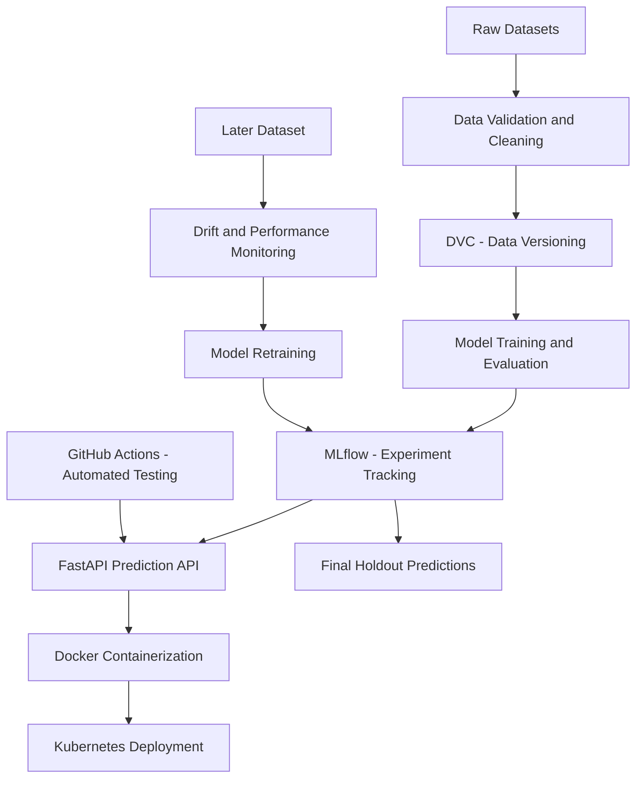

# MP057 – Power Loom Output Prediction

**Course:** SCSE3040 – MLOps Mini Project  
**Group ID:** G066  
**Faculty:** Dhananjay Kumar  
**Batch:** 14

## 1. Project Overview

The **Indore Weavers' Cluster** is a fictional power-loom organisation that wants to predict how many metres of cloth each loom will produce during a working shift.

This project aims to develop a Machine Learning model that predicts production output using factors such as loom age, thread count, power cuts, weaver experience, humidity, shift duration and fabric type.

Since the output is a numerical value (`metres_per_shift`), this is a **Supervised Machine Learning – Regression Problem**.

The project focuses on developing a complete MLOps pipeline, covering data preprocessing, model training, experiment tracking, deployment, monitoring and retraining.

## 2. Dataset Description

The project provides three datasets:

| Dataset | Records | Period | Purpose |
|---|---:|---|---|
| `train.csv` | 1,000 | Jan–June 2026 | Initial model training and data cleaning |
| `later.csv` | 300 | July–August 2026 | Model monitoring, drift detection and retraining |
| `holdout_features.csv` | 250 | September 2026 | Final model predictions |

### Important Dataset Features

| Feature | Description |
|---|---|
| `loom_age_yr` | Age of the loom in years |
| `thread_count` | Thread count |
| `power_cuts_min` | Power-cut duration in minutes |
| `weaver_exp_yr` | Weaver's experience in years |
| `humidity_pct` | Humidity percentage |
| `shift_hours` | Shift duration |
| `fabric` | Type of fabric |
| `shed` | Production shed |
| `metres_per_shift` | Target variable – cloth produced per shift |

The training dataset contains intentional data-quality issues that need to be identified, investigated and corrected.

## 3. Project Workflow



## 4. Technologies Used

- **Programming:** Python
- **Data Processing:** Pandas, NumPy
- **Machine Learning:** Scikit-learn
- **Experiment Tracking:** MLflow
- **Data Version Control:** DVC
- **API Development:** FastAPI
- **Containerization:** Docker
- **CI/CD:** GitHub Actions
- **Deployment Configuration:** Kubernetes
- **Version Control:** Git and GitHub

## 5. Project Objectives

1. Identify and fix data-quality issues in the training dataset.
2. Manage dataset versions using DVC.
3. Train and compare multiple Machine Learning models.
4. Track experiments and register models using MLflow.
5. Develop a prediction API using FastAPI.
6. Containerize the application using Docker.
7. Automate testing using GitHub Actions.
8. Prepare Kubernetes deployment configurations.
9. Monitor data drift and model performance.
10. Retrain the model when required and generate final predictions.

## 6. Expected Output

The final model will predict cloth production for all 250 records in the holdout dataset.

The predictions will be saved in:

`predictions/holdout_predictions.csv`

Expected format:

```csv
record_id,prediction
R50001,0.0
R50002,0.0
```

*Note: The values above are illustrative. Actual predictions will be generated by the trained model.*

## 7. Team Members

| Enrolment Number | Name |
|---|---|
| S24CSEU0816 | Dhruv Mehta |
| S24CSEU1163 | Aditya Tomar |
| S24CSEU1130 | Anchit Gursaraiya Kumar |
| S24CSEU1159 | V. Anurag |

---

**Project Goal:** To build a complete, reproducible MLOps pipeline that transforms raw power-loom production data into a deployable, monitored and continuously improvable Machine Learning solution.

## Local Kubernetes Deployment

The GitHub Actions workflow runs Python compilation and tests, then builds the Docker image without publishing it.

For a local Kubernetes cluster that can access images built by Docker:

```powershell
docker build -t mp057-power-loom:latest .
kubectl apply -f k8s/
kubectl rollout status deployment/mp057-api
kubectl port-forward service/mp057-api 8000:80
```

In another terminal, check `http://localhost:8000/health` and submit a request to `/predict`. The API returns an `X-Request-ID` header and writes structured JSON request and prediction events to its logs; view them with `kubectl logs deployment/mp057-api`.

For a remote cluster, publish the image to a registry accessible by the cluster and update the `image` in `k8s/deployment.yaml` to that registry reference before applying the manifests.
